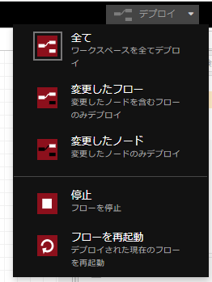
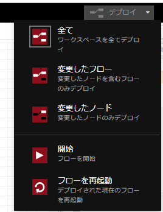
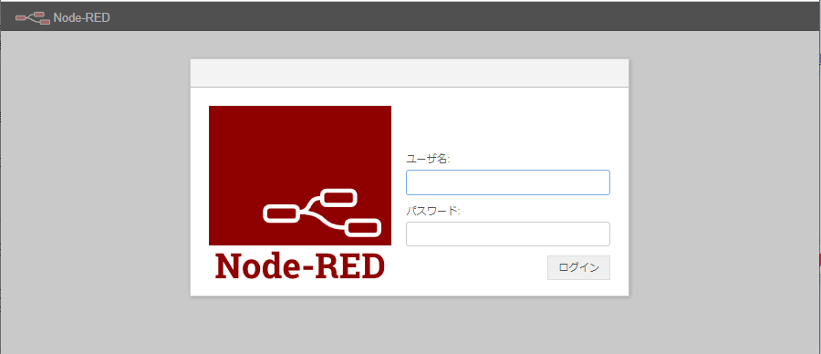
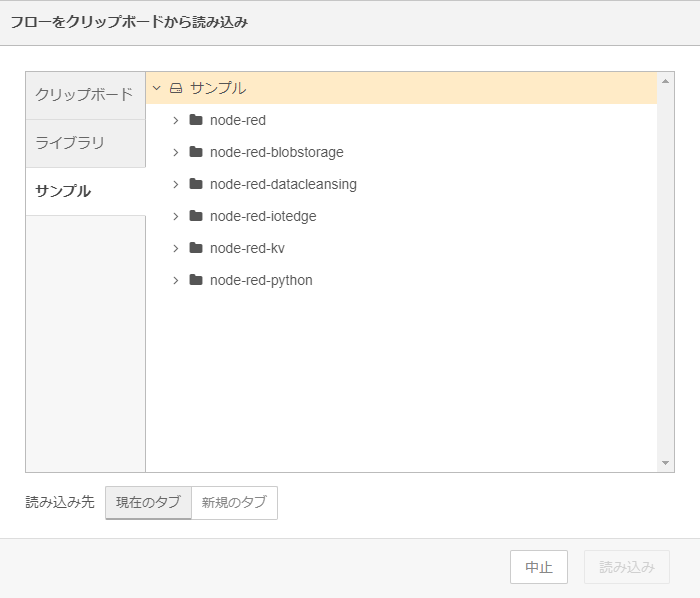
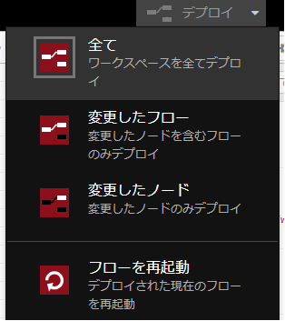

# GAUDINodeRED

## 目次

* [概要](#概要)
* [機能](#機能)
* [Quick Start](#quick-start)
* [ノードモジュール一覧](#ノードモジュール一覧)
* [Pythonツール一覧](#pythonツール一覧)
* [Pythonパッケージ一覧](#pythonパッケージ一覧)
* [イメージのURL](#イメージのurl)
* [動作保証環境](#動作保証環境)
* [モジュールの設定](#モジュールの設定)
  * [設定](#設定)
    * [イメージのURI](#イメージのuri)
    * [起動順序 startupOrder](#起動順序-startuporder)
      * [起動順序 startupOrder の値](#起動順序-startuporder-の値)
      * [起動順序 startupOrder の記入例](#起動順序-startuporder-の記入例)
  * [環境変数](#環境変数)
    * [環境変数の値](#環境変数の値)
  * [コンテナーの作成オプション Create Option](#コンテナーの作成オプション-create-option)
    * [コンテナーの作成オプション Create Option の値](#コンテナーの作成オプション-create-option-の値)
    * [コンテナーの作成オプション Create Option の記入例](#コンテナーの作成オプション-create-option-の記入例)
  * [モジュールツインの設定 Desired Properties](#モジュールツインの設定-desired-properties)
* [ログ出力内容](#ログ出力内容)
  * [IoTEdgeClient](#iotedgeclient)
  * [Module Input](#module-input)
  * [Module Output](#module-output)
  * [Module Twin](#module-twin)
  * [Module Method](#module-method)
* [受信メッセージ](#受信メッセージ)
* [送信メッセージ](#送信メッセージ)
* [NodeREDにおけるメッセージの扱い](#noderedにおけるメッセージの扱い)
* [Direct Method](#direct-method)
* [NodeREDの機能](#noderedの機能)
  * [フロー停止機能](#フロー停止機能)
  * [ユーザー管理機能](#ユーザー管理機能)
* [エラー時動作一覧](#エラー時動作一覧)
* [ユースケース](#ユースケース)
* [フローのデプロイについての注意](#フローのデプロイについての注意)
* [Feedback](#feedback)
* [LICENSE](#license)

## 概要

GAUDINodeREDは、カスタムノードを利用可能な Node-RED を展開します。

## 機能

NodeREDは、フローベースのプログラミングツールである。  
ブラウザのエディタでノード(カスタムノードを含む)を結び付けて、IoTデバイス、API、DBなどと簡単に連携し、データ収集や制御を自動化したフローを作成、実行できる。  
詳細は[NodeREDドキュメント](https://nodered.org/docs/)参照。


## Quick Start
1. Personal Access tokenを作成
（参考: [個人用アクセス トークンを管理する](https://docs.github.com/ja/authentication/keeping-your-account-and-data-secure/managing-your-personal-access-tokens)）
 
2. リポジトリをクローン
```
git clone https://github.com/Project-GAUDI/GAUDINodeRED.git
```
 
3. Dockerイメージをビルド
```
docker image build --build-arg GITHUB_TOKEN=<YOUR_Personal_Access_Token> -t <IMAGE_NAME> ./
```
例）
```
docker image build --build-arg GITHUB_TOKEN=<YOUR_Personal_Access_Token> -t ghcr.io/<YOUR_GITHUB_USERNAME>/gaudinodered:<VERSION> ./
```
 
4. Dockerイメージをコンテナレジストリにプッシュ
```
docker push <IMAGE_NAME>
```
例）
```
docker push ghcr.io/<YOUR_GITHUB_USERNAME>/gaudinodered:<VERSION>
```
 
5. Azure IoT edgeで利用

## イメージのURL
準備中

| URL                                                                     | Description          |
| ----------------------------------------------------------------------- | -------------------- |

## ノードモジュール一覧

導入済ノードライブラリは以下の通り。

| ノードライブラリ名                | 機能概要                       | バージョン | リンク                                                                                                |
| --------------------------------- | ------------------------------ | ---------- | ----------------------------------------------------------------------------------------------------- |
| node-red-blobstorage              | BlobStorage へのアクセス機能   | 7.0.0      | ...                                                                                                   |
| node-red-iotedge                  | iotedge 入出力機能             | 7.0.0      | ...                                                                                                   |
| node-red-kv                       | Keyence レジストリアクセス機能 | 7.0.0      | ...                                                                                                   |
| node-red-python                   | Python コード実行機能          | 7.0.0      | ...                                                                                                   |
| node-red-datacleansing            | データクレンジング機能         | 7.0.0      | ...                                                                                                   |
| node-red-contrib-omron-fins       | オムロンPLCとの通信機能        | 0.5.0      | [node-red-contrib-omron-fins](https://flows.nodered.org/node/node-red-contrib-omron-fins)             |
| node-red-contrib-mcprotocol       | MITSUBISHI PLCとの通信機能     | 1.2.1      | [node-red-contrib-mcprotocol](https://flows.nodered.org/node/node-red-contrib-mcprotocol)             |
| node-red-contrib-python3-function | Python コード実行機能          | 0.0.4      | [node-red-contrib-python3-function](https://flows.nodered.org/node/node-red-contrib-python3-function) |

※ 以下のノードについては動作保証しない。

* 上記以外の標準ノード
* オムロンPLC通信ノード(node-red-contrib-omron-fins)
* MITSUBISHI PLC通信ノード(node-red-contrib-mcprotocol)
* Python コード実行機能(node-red-contrib-python3-function)：**号口環境での利用は非推奨**

## Pythonツール一覧

含まれるPythonツールは以下の通り(依存関係パッケージは表記しない)。

| ツール名          | 機能概要                            | バージョン       |
| ----------------- | ----------------------------------- | ---------------- |
| python3           | python3本体                         | 3.11.2-1+b1      |
| python-is-python3 | symlinks /usr/bin/python to python3 | 3.11.2-1+deb12u1 |
| pip3              | Python package installer            | 26.2.0           |

## Pythonパッケージ一覧

含まれるPythonパッケージは以下の通り(依存関係パッケージは表記しない)。

| パッケージ名       | 機能概要                                 | バージョン |
| ------------------ | ---------------------------------------- | ---------- |
| setuptools         | パッケージ管理                           | 83.0.0    |
| wheel              | パッケージ管理                           | 0.48.0     |
| azure-storage-blob | Azure blob Storageクライアントライブラリ | 12.15.0    |
| pandas             | データ解析機能提供ライブラリ             | 2.3.2      |

## 動作保証環境

| Module Version | IoTEdge | edgeAgent | edgeHub | amd64 verified on | arm64v8 verified on | arm32v7 verified on |
| -------------- | ------- | --------- | ------- | ----------------- | ------------------- | ------------------- |
| 7.0.2          | 1.6.4   | 1.6.4     | 1.6.4   | ubuntu24.04       | －                  | －                  |

## モジュールの設定

### 設定

#### イメージのURI

| URL                                                  | NodeREDバージョン |
| ---------------------------------------------------- | ----------------- |
| `gaudimodules.azurecr.io/iotedge/gaudinodered:7.0.2` | 5.0.8             |

#### 起動順序 startupOrder

##### 起動順序 startupOrder の値

| JSON Key     | Type | Required | Conditions             | Default    | Recommend | Description                                            |
| ------------ | ---- | -------- | ---------------------- | ---------- | --------- | ------------------------------------------------------ |
| startupOrder | uint |          | 0 以上 4294967295 以下 | 4294967295 | 400       | モジュールの起動順序。数字が小さいほど先に起動される。 |

##### 起動順序 startupOrder の記入例

```json
{
  "startupOrder": 400
}
```

### 環境変数

#### 環境変数の値

| Key                         | Type    | Required | Conditions                                                                                                          | Default       | Description                                                                                                                                                                                                                                                                                                                                                                                                                                                                                                                                                                                                                                                                                                              |
| --------------------------- | ------- | -------- | ------------------------------------------------------------------------------------------------------------------- | ------------- | ------------------------------------------------------------------------------------------------------------------------------------------------------------------------------------------------------------------------------------------------------------------------------------------------------------------------------------------------------------------------------------------------------------------------------------------------------------------------------------------------------------------------------------------------------------------------------------------------------------------------------------------------------------------------------------------------------------------------ |
| LogLevel                    | string  |          | ["trace", "debug", "info", "warn", "error"]                                                                         | info          | 出力ログレベル。                                                                                                                                                                                                                                                                                                                                                                                                                                                                                                                                                                                                                                                                                                         |
| EnableMetrics               | boolean |          |                                                                                                                     | false         | メトリクス情報を出力するかのフラグ。<br>true:フロー実行(メッセージ毎)イベントとメモリ使用情報(15秒毎)を出力。                                                                                                                                                                                                                                                                                                                                                                                                                                                                                                                                                                                                            |
| EnablePalette               | boolean |          |                                                                                                                     | true          | パレットマネージャーを表示するかのフラグ。                                                                                                                                                                                                                                                                                                                                                                                                                                                                                                                                                                                                                                                                               |
| EnableFlowStop              | boolean |          |                                                                                                                     | false         | フローを停止させる機能を有効にするかのフラグ。<br>詳細は[フロー停止機能](#フロー停止機能)参照。<br>**フロー停止時、動作不具合の可能性があるため運用レベルでの利用禁止**                                                                                                                                                                                                                                                                                                                                                                                                                                                                                                                                                  |
| EnableHttps                 | boolean |          |                                                                                                                     | false         | https通信を有効にするかのフラグ。<br>true：PrivateKeyFilePath・CertificationFilePathの環境変数設定も必要                                                                                                                                                                                                                                                                                                                                                                                                                                                                                                                                                                                                                 |
| PrivateKeyFilePath          | string  | △        | EnableHttps=true時必須                                                                                              |               | 証明書の秘密鍵ファイルのフルパスを指定する。<br>bindフォルダのパスを想定している。                                                                                                                                                                                                                                                                                                                                                                                                                                                                                                                                                                                                                                       |
| CertificationFilePath       | string  | △        | EnableHttps=true時必須                                                                                              |               | 証明書ファイルのフルパスを指定する。<br>bindフォルダのパスを想定している。                                                                                                                                                                                                                                                                                                                                                                                                                                                                                                                                                                                                                                               |
| EnableUserLogin             | boolean |          |                                                                                                                     | true          | ユーザー管理機能を有効にするかのフラグ。<br>詳細は[ユーザー管理機能](#ユーザー管理機能)参照。                                                                                                                                                                                                                                                                                                                                                                                                                                                                                                                                                                                                                            |
| AdminPassword               | string  | △        | EnableUserLogin=true時必須<br>使用可能文字<br>&emsp;・半角英数字<br>&emsp;・記号(!@#$%^&\*()_-+={}[]\|\\:;"'<>,.?/) | adminP@ssw0rd | Adminユーザーのパスワード<br>**(設定推奨)**                                                                                                                                                                                                                                                                                                                                                                                                                                                                                                                                                                                                                                                                              |
| GuestPassword               | string  | △        | EnableUserLogin=true時必須<br>使用可能文字<br>&emsp;半角英数字<br>&emsp;記号(!@#$%^&\*()_-+={}[]\|\\:;"'<>,.?/)     | guestP@ssw0rd | guestユーザーのパスワード                                                                                                                                                                                                                                                                                                                                                                                                                                                                                                                                                                                                                                                                                                |
| EditorRoot                  | string  |          |                                                                                                                     | /             | エディターにアクセスするためのURLに付与するパス(※1)。<br>例)<br>"/admin"の場合、http://[IP]:[HostPort]/adminでエディタにアクセス可能。                                                                                                                                                                                                                                                                                                                                                                                                                                                                                                                                                                                   |
| SettingsJSPath              | string  |          |                                                                                                                     |               | NodeREDの設定ファイル（Settings.js）のパスを指定する。<br>bindフォルダのパスを想定している。<br>**パス指定時、この表の前の行までの環境変数設定は全て無効となる。<br>主に開発・検証用の為、本設定を行った際の動作保証はしない。**                                                                                                                                                                                                                                                                                                                                                                                                                                                                                         |
| AzureIoTMaxOperationTimeout | number  |          | 240000以上の整数                                                                                                    | 3600000       | EdgeHubとの接続やメッセージ送受信等の通信のタイムアウト時間(ms)。<br>数値以外の文字など無効な値を設定した場合は、デフォルト値を適用する。                                                                                                                                                                                                                                                                                                                                                                                                                                                                                                                                                                                |
| RetryErrorFilter            | string  |          |                                                                                                                     |               | **トラブル回避用のため通常時は利用不可**<br>EdgeHubとの切断時エラー種別によって再接続の要否を判定するフィルタ。<br>この環境変数でフィルタに要否判定の設定ができる。<br>現状、既知のエラーは全て再接続処理に進むよう設定されている。<br>値は"エラー名=[true もしくは false]"の形で設定する。<br>設定した値以外はデフォルト(再接続処理が行われる)から変更されない。<br>true:そのエラーにより切断された時再接続処理に入る。<br>false:そのエラーにより切断された時再接続処理が行われない。<br>複数指定したい場合は、","で繋ぐ。<br>例："xxxxxError=true,TimeoutError=falsenoの場合は、<br>&emsp;xxxxErrorがフィルタに追加、TimeoutErrorがfalseに変更され、<br>&emsp;他のエラーはデフォルトのまま再接続処理される設定となる。 |

※1:URLに利用可能な文字のみ指定可能。それ以外の文字はURLエンコーディングが必要。  
&emsp;&emsp;参考) [URLエンコード対象の文字について](https://ja.wikipedia.org/wiki/%E3%83%91%E3%83%BC%E3%82%BB%E3%83%B3%E3%83%88%E3%82%A8%E3%83%B3%E3%82%B3%E3%83%BC%E3%83%87%E3%82%A3%E3%83%B3%E3%82%B0)

### コンテナーの作成オプション Create Option

#### コンテナーの作成オプション Create Option の値

| JSON Key                               | Type   | Required | Description                                                                                                                         |
| -------------------------------------- | ------ | -------- | ----------------------------------------------------------------------------------------------------------------------------------- |
| HostConfig                             | object | &emsp;   | &emsp;                                                                                                                              |
| &emsp; Binds                           | array  | &emsp;   | NodeRED の設定ファイル格納先をマウントする(※)                                                                                       |
| &emsp; PortBindings                    | object | &emsp;   | &emsp;                                                                                                                              |
| &emsp;&emsp; 1880/tcp                  | array  | &emsp;   | &emsp;                                                                                                                              |
| &emsp;&emsp;&emsp; HostPort            | string | &emsp;   | NodeRED エディタへの接続ポート番号の割当                                                                                            |
| &emsp; Devices                         | array  | &emsp;   | システムデバイスのバインド設定                                                                                                      |
| &emsp; &emsp; {}                       | object | &emsp;   | &emsp;                                                                                                                              |
| &emsp; &emsp; &emsp; CgroupPermissions | string | 〇       | コンテナーグループのパーミッション設定<br>　※"r","w","m" を組み合わせて指定する（例："rw"）<br> ["r": read, "w": write, "m": mknod] |
| &emsp; &emsp; &emsp; PathInContainer   | string | 〇       | コンテナー上のデバイスパス                                                                                                          |
| &emsp; &emsp; &emsp; PathOnHost        | string | 〇       | ホスト上のデバイスパス                                                                                                              |

※注意事項

* コンテナー内の"/data"ディレクトリをローカルにバインドすることを推奨する。  
該当のフォルダをバインドしていない場合、コンテナー削除時などにフローや設定などの編集内容が消失してしまう

#### コンテナーの作成オプション Create Option の記入例

```json
{
  "HostConfig": {
    "Binds": ["/node-red:/data"],
    "PortBindings": {
      "1880/tcp": [
        {
          "HostPort": "1880"
        }
      ]
    }
  }
}
```

### モジュールツインの設定 Desired Properties

ワークスペースのデプロイ内容による

## ログ出力内容

### IoTEdgeClient

| LogLevel | 出力概要                                                                                                                      |
| -------- | ----------------------------------------------------------------------------------------------------------------------------- |
| error    | [クライアント作成/クライアント接続/ツイン取得/タイムアウト設定]失敗<br>クライアント切断<br>クライアントエラー                 |
| warn     | 無し                                                                                                                          |
| info     | クライアント[作成/接続/切断]<br>ツイン作成<br>メッセージサイズ上限拡張設定失敗、デフォルト値設定                              |
| debug    | タイムアウト値<br>エラーフィルター一覧<br>最大メッセージサイズ                                                                |
| trace    | ツイン内容<br>タイムアウト設定[開始/取得開始]<br>エラーフィルター[設定取得開始/設定]<br> メッセージサイズ上限拡張設定取得開始 |

### Module Input

| LogLevel | 出力概要                                  |
| -------- | ----------------------------------------- |
| error    | [クライアント取得/受信メッセージ出力]失敗 |
| warn     | 無し                                      |
| info     | ノード作成<br>メッセージ受信              |
| debug    | 無し                                      |
| trace    | 受信メッセージ                            |

### Module Output

| LogLevel | 出力概要                              |
| -------- | ------------------------------------- |
| error    | [クライアント取得/メッセージ送信]失敗 |
| warn     | 無し                                  |
| info     | ノード作成<br>メッセージ送信          |
| debug    | 無し                                  |
| trace    | 送信メッセージ                        |

### Module Twin

| LogLevel | 出力概要                                        |
| -------- | ----------------------------------------------- |
| error    | モジュールツインエラー<br>クライアント未初期化  |
| warn     | 無し                                            |
| info     | desiredProperties更新<br>reportedProperties更新 |
| debug    | 無し                                            |
| trace    | desiredProperties更新内容                       |

### Module Method

| LogLevel | 出力概要                                                               |
| -------- | ---------------------------------------------------------------------- |
| error    | ダイレクトメソッド返信送信失敗                                         |
| warn     | 無し                                                                   |
| info     | ノード作成<br>ダイレクトメソッド呼び出し<br>ダイレクトメソッド返信成功 |
| debug    | 無し                                                                   |
| trace    | ダイレクトメソッドリクエスト<br>受信ダイレクトメソッド                 |

## 受信メッセージ

* ModuleInputノードを通して他のモジュールからのメッセージ受信を行う
* メッセージのBody, Propertyがmsgオブジェクトに格納される。
* メッセージの内容については[NodeREDにおけるメッセージの扱い](#noderedにおけるメッセージの扱い)を参照
* ModuleInputノードでメッセージ受信時にPropertyとして下記の情報が追加される
  * $.cdidプロパティ(properties配下): 送信元デバイス名
  * $.cmidプロパティ(properties配下): 送信元モジュール名

## 送信メッセージ

* ModuleOutputノードから他のモジュールへのメッセージ送信を行う
* メッセージの内容については[NodeREDにおけるメッセージの扱い](#noderedにおけるメッセージの扱い)を参照
* ModuleOutputノードでメッセージ送信時に下記の操作を行う
  * $.cdidプロパティ(properties配下): 削除
  * $.cmidプロパティ(properties配下): 削除

## NodeREDにおけるメッセージの扱い

* NodeRED上ではメッセージはjavascriptベースのmsgオブジェクトで入出力される
* 基本的にはmsg.payloadが主な入出力値の格納先になる
* 他のモジュールからのメッセージ受信はModuleInputノード、モジュールへのメッセージ送信はModuleOutputノードを使用する
  * 送受信時のデータ構成は下記のようになっている

    | JSON Key            | Type   | Description                  |
    | ------------------- | ------ | ---------------------------- |
    | payload             | any    | メッセージの Body 相当       |
    | properties          | object | メッセージの Property 格納先 |
    | &emsp; propertyList | array  | メッセージの Property 相当   |
    | &emsp; &emsp; key   | string | プロパティ名                 |
    | &emsp; &emsp; value | string | プロパティの値               |

    ```json
    {
      "payload": {
        "RecordList": [
          {
            "RecordHeader": ["sample.csv"],
            "RecordData": ["A1", "B1", "C1", "D1", "E1"]
          }
        ]
      },
      "properties": {
        "propertyList": [
          { "key": "filename", "value": "sample.csv" },
          { "key": "row_number", "value": "1" },
          { "key": "row_total", "value": "5" },
          { "key": "$.cdid", "value": "topLayerDevice" },
          { "key": "$.cmid", "value": "csvfilereceiver01" }
        ]
      }
    }
    ```

## Direct Method

ModuleMethodノードを起点にダイレクトメソッドを実装する (詳細は「[GAUDI-NodeRED開発ノウハウ.xlsx](https://toyotashokki.sharepoint.com/:x:/s/GAUDI/Eew_exGH9SlOl1gei-b9Zs8B1Nuiz16KTjqt8C5G9WLGfQ?e=BowTEQ)」資料)

## NodeREDの機能

環境変数で有効/無効を設定できる機能について説明する。

### フロー停止機能

環境変数の「EnableFlowStop」をtrueに設定することで有効になる。  
有効にした場合、デプロイボタン横の▽から開けるリストに「停止」が含まれるようになる。  
一度「停止」を押すと、そのボタンは「開始」に切り替わる。




フローが停止した状態でも、ノードの編集・デプロイは可能になっている。  
また、"/data"フォルダのバインドを行っている場合はコンテナーの再起動・削除を行っても停止・開始状態は保持され続ける。

### ユーザー管理機能

環境変数の「EnableUserLogin」をtrueに設定することで有効になる。  
有効にした場合、エディタを開く際にログイン操作が必要になる。



本システムでは、以下のユーザが利用可能。

| ユーザ名 | パスワード                                       | 使用不可機能                         |
| -------- | ------------------------------------------------ | ------------------------------------ |
| admin    | adminP@ssw0rd or 環境変数「AdminPassword」で設定 | 無し                                 |
| guest    | guestP@ssw0rd or 環境変数「GuestPassword」で設定 | デプロイ・設定・パレットマネージャー |

## エラー時動作一覧

| 分類         | エラー内容                                             | 動作                             | 出力ログレベル |
| ------------ | ------------------------------------------------------ | -------------------------------- | -------------- |
| **環境変数** | 条件付き必須項目が未設定                               | アプリケーションが異常終了する。 | error          |
| &emsp;       | 省略可能項目がConditions制約違反                       | アプリケーションが異常終了する。 | error          |
| &emsp;       | 省略可能項目がType制約違反                             | アプリケーションが異常終了する。 | error          |
| &emsp;       | PrivateKeyFilePathに証明書の秘密鍵ファイルが存在しない | アプリケーションが異常終了する。 | error          |
| &emsp;       | CertificationFilePathに証明書ファイルが存在しない      | アプリケーションが異常終了する。 | error          |
| &emsp;       | SettingsJSPathにsetting.jsが存在しない                 | アプリケーションが異常終了する。 | error          |

## ユースケース

基本ノードや各カスタムノードのサンプルフローは、メニューの「読み込み」から挿入することが可能なため、そちらを参照



## フローのデプロイについての注意

> フローのデプロイを実施する際、必ず **「全て」デプロイ**を使用する。  
> 想定しない動作を引き起こす可能性があるため、他種別のデプロイ(「更新したフロー」「更新したノード」)は使用しない。  
> 

## Feedback

お気づきの点があれば、ぜひIssueにてお知らせください。

## LICENSE

GAUDINodeRED is licensed under the MIT License, see the [LICENSE](LICENSE) file for details.
